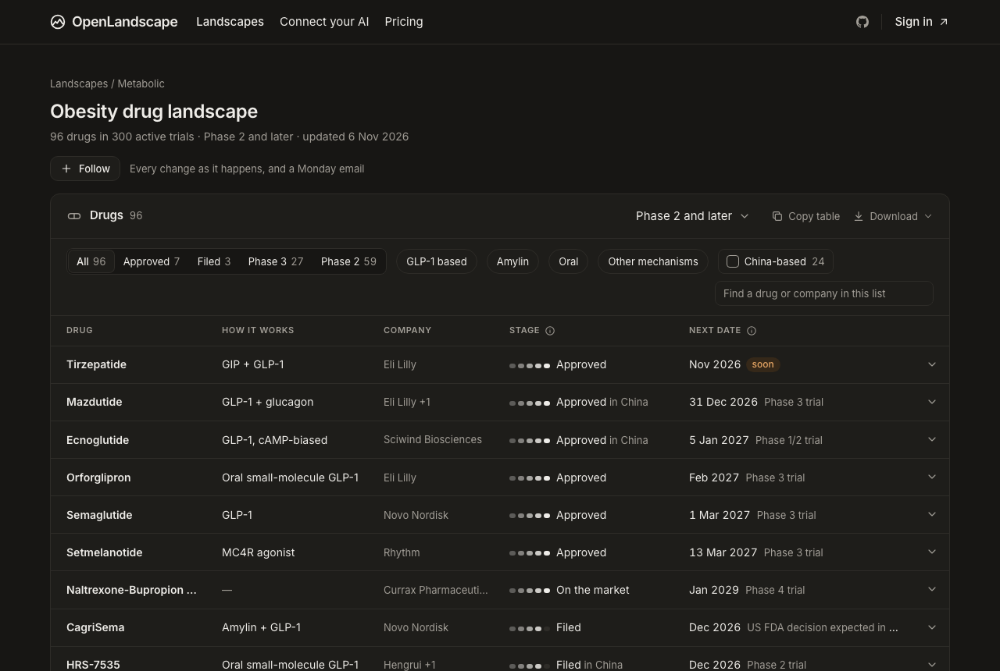

# OpenLandscape

Open drug-pipeline landscapes. Pick a disease, target or company and see every drug in development: who owns it,
how it works, how far it has got, its active trials and what happens next. Every fact links to its source
(ClinicalTrials.gov, the EU trials register, FDA, EMA, SEC filings, company news).

**[openlandscape.app](https://openlandscape.app)**



- Free sample, no account: [the obesity drug pipeline](https://openlandscape.app/landscapes/obesity)
- Use it from Claude, ChatGPT, Cursor or any MCP app: [openlandscape.app/connect](https://openlandscape.app/connect)

## Why it exists

Pipeline databases such as Citeline are sold to big pharma for tens of thousands a year, after a sales call. Smaller
biotechs, consultants and investors build the same landscapes by hand in spreadsheets. OpenLandscape does that work
from public sources and shows where every line comes from.

- **Free:** no card, no time limit. The top 10 of any list, one landscape in full and 25 AI questions a month.
  The ready-made landscapes are free to read without an account.
- **Solo:** $49 a month or $490 a year (before VAT), for one person. Every list in full, follows, and every change as it happens.

Details: [openlandscape.app/pricing](https://openlandscape.app/pricing).

## Use it from your AI assistant (MCP)

OpenLandscape is a remote MCP server (Streamable HTTP). Server URL:

```
https://openlandscape.app/mcp
```

You sign in with your OpenLandscape account (OAuth) the first time; a free account works.

- **Claude** (app or claude.ai): find OpenLandscape in the connector directory, or **Settings → Connectors → Add
  custom connector**, name it OpenLandscape and paste the URL.
- **Claude Code:**

  ```bash
  claude mcp add --transport http openlandscape https://openlandscape.app/mcp
  ```

- **Cursor:** add to `~/.cursor/mcp.json`:

  ```json
  { "mcpServers": { "openlandscape": { "url": "https://openlandscape.app/mcp" } } }
  ```

- **Gemini CLI:** add to `~/.gemini/settings.json`, restart, and type `/mcp` to check:

  ```json
  { "mcpServers": { "openlandscape": { "httpUrl": "https://openlandscape.app/mcp" } } }
  ```

- **ChatGPT** and other apps: step-by-step on [openlandscape.app/connect](https://openlandscape.app/connect).

Then ask, for example: *"Map every amylin drug in Phase 2 or later, with next milestones."*

Tools: `search`, `landscape`, `trials`, `catalysts`, `who_runs_trials`, `drug`, `changes`, `whoami`, and `show`
(draws the answer as a card in apps that support it). Every answer carries its sources.

More for AI tools: [openlandscape.app/ai](https://openlandscape.app/ai) and [openlandscape.app/llms.txt](https://openlandscape.app/llms.txt).

## What is in this copy, and what is not

This repository is the open-source copy of the code. It has everything the site runs on: the data loaders, the
grouping of trials into drugs, the website, sign-in, billing, the AI connector and the checks.

It does not have the checked data. People check the rows by hand: which trial belongs to which drug, which company
owns what, which names mean the same drug. That work is what OpenLandscape sells, so it stays private. Also private:
company logos and the list of company aliases (for example that "GSK" means GlaxoSmithKline).

So a copy you build yourself is thinner than the live site:

- One checked area: obesity (`seed/obesity.js`), as a sample of what the checked data looks like.
- Every other area is grouped automatically from the registry names. It works, but expect more duplicates and
  more drugs without a known company or target.
- No company logos. Some company searches by short name find nothing.
- The files that hold checked data are empty stand-ins with the right shape (in `seed/`), so the code runs.

## Run it on your computer

Needs Node 22 or later, and about 1 GB of free disk space.

```bash
npm install
npm run ingest      # downloads trials from ClinicalTrials.gov and approvals from openFDA, builds the database (15 to 20 minutes)
npm start           # http://localhost:8080
```

Then open [localhost:8080/landscapes/obesity](http://localhost:8080/landscapes/obesity).

The database is one SQLite file, `data/openpipeline.db` (a few hundred MB). `npm run ingest` builds it from public
sources only. Most of the time goes on looking up drug names in public drug lists (the FDA substance registry and
the NCI drug dictionary) and FDA labels. The drug-list lookups stop after a few minutes, so some names are not
asked, and a few rows that are the same drug stay apart. Run `npm run ingest` again to refresh.

No keys are needed to run it locally:

- Without an email service, sign-in links are printed in the server log and shown on the page.
- Without a Stripe key, the pricing page shows, but checkout says payments are not configured.

To add keys, copy `.env.example` to `.env` and fill in what you need. [SETUP.md](SETUP.md) lists every account and
key, and how to run your own server.

### Run the checks

```bash
TODAY=2026-11-06 npm run check
```

`TODAY` fixes the date, so date-based checks give the same answer on any day. Some checks need the private checked
data. In this copy they print `SKIP` and do not fail. That is expected.

## How it works

| Piece | What it does | Where |
|---|---|---|
| Trial loader | Downloads industry drug trials (phase 1 to 4) from the ClinicalTrials.gov API | `src/ingest/ctgov.js` |
| Approval loader | Downloads the FDA's list of approved drugs (openFDA) | `src/ingest/openfda.js` |
| Checked data | Hand-checked companies, drug names, approvals and filings, with sources | `seed/` (obesity only here) |
| Grouping | Groups trials into drugs, merges names for the same drug (mazdutide = LY3305677 = IBI362), skips placebo and comparator arms | `src/ingest/link.js` |
| Questions | Search, landscape, trials, catalysts, who runs trials, one drug, recent changes | `src/query.js` |
| AI connector | The same questions for AI apps, as a remote MCP server | `src/mcp.js` |
| Website | Landscape pages, dashboard, pricing, Stripe checkout, email sign-in | `src/server.js`, `src/pages/`, `web/` |
| Client | The connector setup for Claude and ChatGPT, and skills for writing landscape memos | `client/` |

Checked areas are listed in `seed/index.js`. To check a new area, add a seed file in the same format as
`seed/obesity.js` and list it there.

**Why the ClinicalTrials.gov API and not AACT?** AACT is a nightly database copy of the same registry. It needs an
account, and we only need the industry drug trials, a small part of it. The official API serves the same records
with no account.

## The AI connector

The connector is a remote MCP server at `/mcp`. AI apps sign in with OAuth (`src/oauth.js`); `/mcp/u/<api-key>`
also works for apps that take a plain address. It has eight tools:

`whoami`, `search`, `landscape`, `trials`, `catalysts`, `who_runs_trials`, `drug`, `changes`.

A ninth tool, `show`, draws the answer as a card inside Claude or ChatGPT. Set `AI_CARDS=0` in `.env` to turn cards
off; `show` then goes away and the tools answer in text only.

## Rules the product follows

1. Every phase, date and number links to its source.
2. Facts from press reports carry a "news" tag. Name merges and mechanisms not yet confirmed carry an orange dot.
3. Every page says when the data was pulled.
4. Features not built yet show the month they ship.

## Contributing and security

- How to send changes: [CONTRIBUTING.md](CONTRIBUTING.md)
- How to report a security problem: [SECURITY.md](SECURITY.md). Please do not open a public issue for it.

## Licence

- The app (server, data loaders, AI connector, website): AGPL-3.0, see `LICENSE`.
- The client (`client/`): MIT, see `client/LICENSE`.

The data the app downloads comes from ClinicalTrials.gov, openFDA and SEC EDGAR, under their own terms.
